# Especificação do Diagrama de Classes e Arquitetura Orientada a Objetos

**Projeto:** Sistema Desktop de Almoxarifado para Indústria de Bebidas  
**Tecnologia:** Java 17+ / JavaFX / NetBeans / JDBC  
**Padrão Arquitetural:** MVC (Model-View-Controller) + DAO (Data Access Object) + Service Layer  

Este documento define todas as classes do sistema com seus respectivos atributos, tipos, visibilidades e métodos para que qualquer desenvolvedor ou agente de IA possa implementar o código-fonte diretamente sem ambiguidades.

---

## 1. Diagrama Geral de Classes (Mermaid)

```mermaid
classDiagram
    direction TB

    %% Model / Entities
    class Cargo {
        -int id
        -String nome
        +Cargo()
        +Cargo(int id, String nome)
        +getId() int
        +setId(int id) void
        +getNome() String
        +setNome(String nome) void
        +toString() String
    }

    class Funcionario {
        -int id
        -String nome
        -String cpf
        -String email
        -String senha
        -Cargo cargo
        +Funcionario()
        +Funcionario(int id, String nome, String cpf, String email, String senha, Cargo cargo)
        +getId() int
        +getNome() String
        +getEmail() String
        +getSenha() String
        +getCargo() Cargo
        +validarSenha(String senhaInformada) boolean
    }

    class Fornecedor {
        -int id
        -String nome
        -String cnpj
        +Fornecedor()
        +Fornecedor(int id, String nome, String cnpj)
        +getId() int
        +getNome() String
        +getCnpj() String
        +toString() String
    }

    class Setor {
        -int id
        -String nome
        +Setor()
        +Setor(int id, String nome)
        +getId() int
        +getNome() String
        +toString() String
    }

    class TipoInsumo {
        -int id
        -String nome
        -int quantidadeMinima
        -String unidadePadrao
        +TipoInsumo()
        +TipoInsumo(int id, String nome, int quantidadeMinima)
        +getId() int
        +getNome() String
        +getQuantidadeMinima() int
        +setNome(String nome) void
        +setQuantidadeMinima(int quantidadeMinima) void
        +toString() String
    }

    class LoteInsumo {
        -int id
        -TipoInsumo tipoInsumo
        -Fornecedor fornecedor
        -String lote
        -LocalDate validade
        -int volumeInicial
        -String unidadeMedida
        -Setor setorArmazenamento
        +LoteInsumo()
        +getId() int
        +getLote() String
        +getValidade() LocalDate
        +getTipoInsumo() TipoInsumo
        +getFornecedor() Fornecedor
        +isVencido() boolean
        +toString() String
    }

    class TipoMovimentacao {
        -int id
        -String nome
        -String operacao
        +TipoMovimentacao()
        +TipoMovimentacao(int id, String nome, String operacao)
        +getId() int
        +getNome() String
        +getOperacao() String
        +isEntrada() boolean
    }

    class Movimentacao {
        -int id
        -LoteInsumo loteInsumo
        -TipoMovimentacao tipoMovimentacao
        -int quantidade
        -Setor setorSolicitante
        -Funcionario funcionarioResponsavel
        -LocalDateTime dataHora
        +Movimentacao()
        +getId() int
        +getQuantidade() int
        +getDataHora() LocalDateTime
        +getLoteInsumo() LoteInsumo
        +getTipoMovimentacao() TipoMovimentacao
        +getFuncionarioResponsavel() Funcionario
        +getSetorSolicitante() Setor
    }

    class InsumoEstoqueDTO {
        -int idTipoInsumo
        -String nomeInsumo
        -int saldoDisponivel
        -int quantidadeMinima
        -String unidadeMedida
        -boolean nivelCritico
        -LocalDate proximaValidade
        +InsumoEstoqueDTO()
        +getNomeInsumo() String
        +getSaldoDisponivel() int
        +getQuantidadeMinima() int
        +isNivelCritico() boolean
    }

    %% Relacionamentos de Model
    Funcionario --> Cargo : possui
    LoteInsumo --> TipoInsumo : classifica
    LoteInsumo --> Fornecedor : fornecido por
    LoteInsumo --> Setor : estocado em
    Movimentacao --> LoteInsumo : afeta
    Movimentacao --> TipoMovimentacao : tipo
    Movimentacao --> Setor : setor solicitante
    Movimentacao --> Funcionario : registrado por

    %% DAO Layer
    class FuncionarioDAO {
        +autenticar(String email, String senha) Funcionario
        +buscarPorId(int id) Funcionario
        +listarTodos() List~Funcionario~
    }

    class TipoInsumoDAO {
        +inserir(TipoInsumo insumo) boolean
        +atualizar(TipoInsumo insumo) boolean
        +excluir(int id) boolean
        +buscarPorId(int id) TipoInsumo
        +listarTodos() List~TipoInsumo~
        +pesquisarPorTermo(String termo) List~TipoInsumo~
    }

    class LoteInsumoDAO {
        +inserir(LoteInsumo lote) boolean
        +listarPorTipoInsumo(int idTipo) List~LoteInsumo~
        +buscarPorId(int id) LoteInsumo
        +listarTodos() List~LoteInsumo~
    }

    class MovimentacaoDAO {
        +registrarMovimentacao(Movimentacao mov) boolean
        +listarHistorico() List~Movimentacao~
        +calcularSaldoPorTipoInsumo(int idTipoInsumo) int
        +calcularSaldoPorLote(int idLote) int
        +listarInsumosEmNivelCritico() List~InsumoEstoqueDTO~
        +listarEstoqueConsolidado() List~InsumoEstoqueDTO~
    }

    %% Service Layer
    class AuthService {
        -FuncionarioDAO funcionarioDAO
        +login(String email, String senha) Funcionario
        +logout() void
    }

    class InsumoService {
        -TipoInsumoDAO tipoInsumoDAO
        -LoteInsumoDAO loteInsumoDAO
        -MovimentacaoDAO movimentacaoDAO
        +salvarInsumo(TipoInsumo insumo) void
        +atualizarInsumo(TipoInsumo insumo) void
        +excluirInsumo(int id) void
        +filtrarInsumos(String termo) List~TipoInsumo~
        +obterEstoqueConsolidado() List~InsumoEstoqueDTO~
    }

    class MovimentacaoService {
        -MovimentacaoDAO movimentacaoDAO
        -OrdenacaoService ordenacaoService
        +registrarOperacao(Movimentacao mov) boolean
        +validarDisponibilidade(int idLote, int qtdSaida) boolean
        +listarInsumosOrdenadosAlfabeticamente() List~TipoInsumo~
        +verificarNivelCritico(int idTipoInsumo) boolean
    }

    class OrdenacaoService {
        +ordenarInsumosPorNome(List~TipoInsumo~ lista) void
        -quickSort(List~TipoInsumo~ lista, int inicio, int fim) void
        -particionar(List~TipoInsumo~ lista, int inicio, int fim) int
        -trocar(List~TipoInsumo~ lista, int i, int j) void
    }

    %% Controllers JavaFX
    class LoginController {
        -TextField txtEmail
        -PasswordField txtSenha
        -Label lblMensagemErro
        -AuthService authService
        +handleEntrar() void
        +limparCampos() void
    }

    class HomeController {
        -Label lblUsuarioLogado
        -Label lblCargo
        -Button btnInsumos
        -Button btnMovimentacao
        -Button btnSair
        +handleAbrirInsumos() void
        +handleAbrirMovimentacao() void
        +handleLogout() void
    }

    class InsumosController {
        -TableView~InsumoEstoqueDTO~ tabelaInsumos
        -TextField txtPesquisa
        -TextField txtNome
        -TextField txtQtdMinima
        -InsumoService insumoService
        +handlePesquisar() void
        +handleSalvar() void
        +handleEditar() void
        +handleExcluir() void
        +handleVoltarHome() void
    }

    class MovimentacaoController {
        -ComboBox~TipoInsumo~ cbInsumos
        -ComboBox~LoteInsumo~ cbLotes
        -ComboBox~TipoMovimentacao~ cbTipoMovimentacao
        -ComboBox~Setor~ cbSetores
        -TextField txtQuantidade
        -DatePicker dpData
        -Label lblResponsavel
        -MovimentacaoService movimentacaoService
        +carregarInsumosOrdenados() void
        +handleConfirmarMovimentacao() void
        +handleVoltarHome() void
    }

    %% Utilities
    class SessaoUsuario {
        -Funcionario usuarioAutenticado$
        +iniciarSessao(Funcionario f)$ void
        +getUsuarioAutenticado()$ Funcionario
        +encerrarSessao()$ void
        +isAutenticado()$ boolean
    }

    class AlertaUtil {
        +mostrarInformacao(String titulo, String msg)$ void
        +mostrarErro(String titulo, String msg)$ void
        +mostrarAvisoCritico(String titulo, String msg)$ void
        +confirmar(String titulo, String msg)$ boolean
    }

    class DatabaseConnection {
        -String URL$
        -String USER$
        -String PASSWORD$
        +getConnection()$ Connection
    }

    %% Relacionamentos de Camadas
    AuthService --> FuncionarioDAO
    InsumoService --> TipoInsumoDAO
    InsumoService --> LoteInsumoDAO
    InsumoService --> MovimentacaoDAO
    MovimentacaoService --> MovimentacaoDAO
    MovimentacaoService --> OrdenacaoService
    LoginController --> AuthService
    InsumosController --> InsumoService
    MovimentacaoController --> MovimentacaoService
    LoginController ..> SessaoUsuario
    HomeController ..> SessaoUsuario
    MovimentacaoController ..> SessaoUsuario
```

---

## 2. Detalhamento dos Pacotes e Classes

### 2.1. Pacote `com.senai.bebidas.model`
Contém as entidades de domínio mapeadas diretamente para as tabelas do banco `bebidas_db` e objetos de transferência de dados (DTOs):

1. **`Cargo`**: Representa os cargos na fábrica (ex: "Supervisor de Produção", "Operador de Almoxarifado").
2. **`Funcionario`**: Armazena dados dos usuários do sistema (`id`, `nome`, `cpf`, `email`, `senha`, `cargo`).
3. **`Fornecedor`**: Fornecedores de insumos (`id`, `nome`, `cnpj`).
4. **`Setor`**: Setores da fábrica solicitantes ou destinos de insumos (`id`, `nome`). Ex: "Linha de Envase", "Preparação de Xarope", "Almoxarifado Central".
5. **`TipoInsumo`**: Categoria base do material (`id`, `nome`, `quantidadeMinima`). Exemplos: Concentrado de Guaraná, Açúcar Cristal, Garrafas PET 2L.
6. **`LoteInsumo`**: Instância específica do insumo estocado com rastreabilidade de fabricação (`id`, `tipoInsumo`, `fornecedor`, `lote`, `validade`, `volumeInicial`, `unidadeMedida`, `setorArmazenamento`).
7. **`TipoMovimentacao`**: Classificação da operação (`id`, `nome`, `operacao`). Ex: "Entrada por Fornecedor (+)", "Saída para Envase (-)", "Perda por Avaria (-)".
8. **`Movimentacao`**: Registro imutável de movimentação (`id`, `loteInsumo`, `tipoMovimentacao`, `quantidade`, `setorSolicitante`, `funcionarioResponsavel`, `dataHora`).
9. **`InsumoEstoqueDTO`**: Objeto para exibição na tabela da interface (`idTipoInsumo`, `nomeInsumo`, `saldoDisponivel`, `quantidadeMinima`, `unidadeMedida`, `nivelCritico`).

### 2.2. Pacote `com.senai.bebidas.dao`
Responsável pela persistência e consultas via JDBC:
* **`FuncionarioDAO`**: Autentica credenciais com PreparedStatements seguros contra SQL Injection.
* **`TipoInsumoDAO`**: CRUD completo de insumos e busca textual com `LIKE %termo%`.
* **`LoteInsumoDAO`**: Cadastro e consulta de lotes e validades.
* **`MovimentacaoDAO`**: Inserção de movimentações, cálculo dinâmico de saldo por lote e insumo, e consulta de estoque consolidado.

### 2.3. Pacote `com.senai.bebidas.service`
Camada onde residem as regras de negócio:
* **`AuthService`**: Valida regras de login, inicializa `SessaoUsuario`.
* **`InsumoService`**: Valida nomes não vazios, quantidades válidas e integridade antes de chamar o DAO.
* **`MovimentacaoService`**: Impede saídas maiores que o saldo em estoque, dispara o registro em transação e verifica se o saldo atingiu o nível crítico.
* **`OrdenacaoService`**: Implementa o algoritmo **Quicksort** puro em Java para ordenar alfabeticamente a lista de insumos sem depender de bibliotecas externas, atendendo ao requisito 7.1.2 do edital.

### 2.4. Pacote `com.senai.bebidas.controller`
Controladores JavaFX vinculados aos arquivos FXML:
* **`LoginController`**: Coleta dados da tela, valida e redireciona.
* **`HomeController`**: Exibe boas-vindas com nome do funcionário autenticado e gerencia navegação.
* **`InsumosController`**: Controla tabela, filtro dinâmico de pesquisa, diálogos de inclusão, edição e exclusão.
* **`MovimentacaoController`**: Carrega insumos ordenados via Quicksort, processa entradas e saídas e emite alerta caso o estoque fique crítico.

### 2.5. Pacote `com.senai.bebidas.util`
Classes utilitárias transversais:
* **`DatabaseConnection`**: Conexão Singleton JDBC com MySQL.
* **`SessaoUsuario`**: Guarda estaticamente o funcionário logado durante o ciclo de vida da aplicação desktop.
* **`AlertaUtil`**: Centraliza caixas de diálogo e notificações visuais JavaFX.
