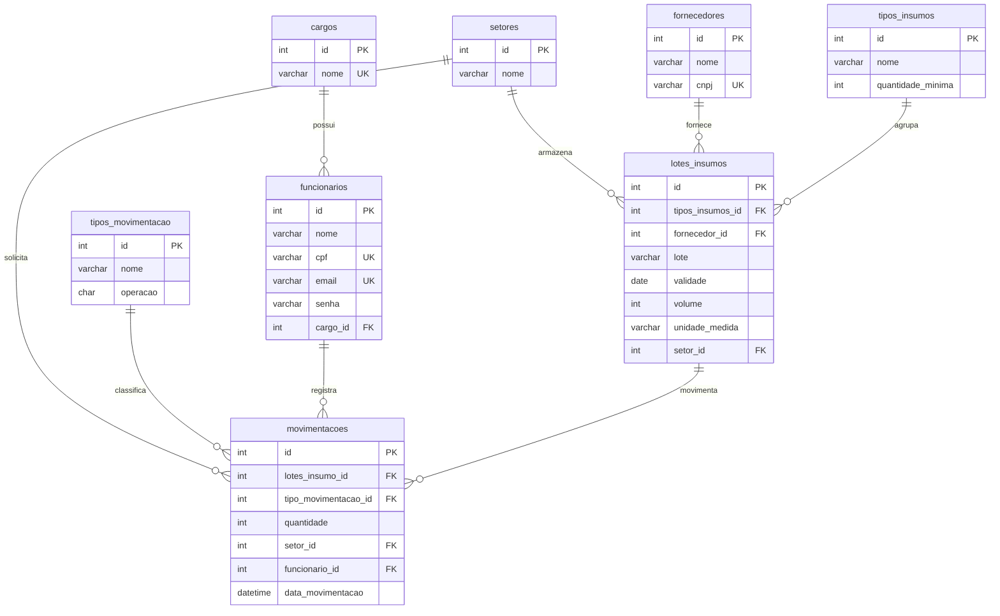

# Relatório de Revisão do Banco de Dados e Diagrama DER

**Projeto:** Sistema Desktop de Almoxarifado para Indústria de Bebidas (`bebidas_db`)  
**Arquivos Analisados e Sincronizados:**
1. `Entregaveis/Banco de Dados/bebidas_db_2026-09-22T13_51_34.971Z.json` (Modelo exportado do DrawDB)
2. `Entregaveis/Banco de Dados/bebidas_db_2026-10-13T14_02_26.535Z.jpeg` (Captura visual do DER)
3. `Entregaveis/Banco de Dados/BancodoProjeto.sql` (Script SQL oficial de DDL e DML)

---

## 1. Pontos Fortes da Modelagem Atual
* **Separação entre Tipo de Insumo e Lote:** A distinção entre `tipos_insumos` (definição abstrata: Concentrado de Guaraná, Garrafa PET 2L) e `lotes_insumos` (instância física com validade e fornecedor) é excelente e reflete a realidade industrial de rastreabilidade (FIFO/PEPS).
* **Livro-Razão de Movimentações (Ledger Pattern):** A tabela `movimentacoes` atuando como histórico contábil de entradas e saídas garante que nenhum dado histórico seja perdido, atendendo com folga a RN-04.
* **Views de Saldo Dinâmicas:** A implementação de `vw_quantidade_atual_por_lote` e `vw_quantidade_atual` automatiza o cálculo do estoque dinâmico sem armazenar campos calculados redundantes propensos a desincronização.
* **Rastreabilidade e Auditoria:** Cada movimentação registra o operador (`funcionario_id`), data/hora exata (`data_movimentacao`) e setor de destino (`setor_id`).

---

## 2. Inconsistências Identificadas e Resoluções Aplicadas

### ✅ Resolução 1: Atendimento à Regra de Mínimo de 3 Registros (Edital SENAI)
* **O que diz o Edital (Item 3.2):** *"O script deverá conter tabelas (...), relacionamentos e **pelo menos três registros para cada tabela criada**."*
* **Ação Aplicada:** O script SQL (`BancodoProjeto.sql`) contém no mínimo 3 registros consistentes cadastrados para todas as 8 tabelas do sistema (`cargos`, `tipos_movimentacao`, `tipos_insumos`, `fornecedores`, `setores`, `lotes_insumos`, `funcionarios` e `movimentacoes`).

### ✅ Resolução 2: Criação e Seleção Explícita do Banco de Dados
* **Problema Original:** Ausência de `CREATE DATABASE` e `USE bebidas_db`.
* **Ação Aplicada:** O script inicia com a criação formal do banco com charset `utf8mb4` e collation `utf8mb4_unicode_ci`, seguido de `USE bebidas_db;` e limpeza preventiva (`DROP`) de views e tabelas.

### ✅ Resolução 3: Decisão Arquitetural Consolidada — Padrão Ledger e Campo `volume`
* **Definição:** O cálculo do saldo nas views (`vw_quantidade_atual` e `vw_quantidade_atual_por_lote`) segue formalmente o **Padrão Livro-Razão (Ledger Contábil)**, computando `Somatório(Entradas) - Somatório(Saídas + Perdas)` a partir da tabela `movimentacoes`.
* **Papel do Campo `volume`:** O campo `volume` em `lotes_insumos` representa a **capacidade nominal / volume de embalagem** do lote (ex.: tambor de 200L, saco de 50kg), enquanto o saldo físico real disponível é derivado exclusivamente dos lançamentos contábeis.
* **Alinhamento do Diagrama DrawDB:** Os comentários das views no arquivo `.json` foram atualizados para refletir essa lógica contábil, eliminando qualquer ambiguidade entre a modelagem conceitual e o script SQL.
* **Garantia de Negócio:** No momento do cadastro de um lote (seja no script SQL ou via JavaFX na camada `Service`), gera-se atomicamente uma movimentação inicial de "Entrada por Fornecedor" para alimentar o saldo.

### ✅ Resolução 4: Restrições `UNIQUE` em Campos Críticos
* **Ação Aplicada:**
  * `funcionarios.email` e `funcionarios.cpf` possuem restrição `UNIQUE` (imprescindível para autenticação e integridade).
  * `fornecedores.cnpj` possui restrição `UNIQUE` tanto no script SQL quanto no DrawDB JSON.
  * `cargos.nome` possui restrição `UNIQUE`.

### ✅ Resolução 5: Padronização de Nomenclatura e Case Sensitivity
* **Problema Original:** Mistura de maiúsculas no SQL com minúsculas no JSON, e termos no singular (`cargo`, `LOTES_INSUMO`, `TIPO_MOVIMENTACAO`).
* **Ação Aplicada:** Todas as tabelas foram padronizadas em minúsculas com snake_case e plural consistente (`cargos`, `tipos_movimentacao`, `tipos_insumos`, `fornecedores`, `setores`, `lotes_insumos`, `funcionarios`, `movimentacoes`), garantindo total portabilidade para Windows, Linux e Docker (`lower_case_table_names`).

### ✅ Resolução 6: Tratamento de Palavra Reservada (`data` -> `data_movimentacao`)
* **Problema Original:** Uso do termo genérico e reservado `data`.
* **Ação Aplicada:** O campo foi padronizado como `data_movimentacao DATETIME NOT NULL DEFAULT CURRENT_TIMESTAMP` no script SQL e no DrawDB JSON.

### ✅ Resolução 7: Classificação de Operações de Movimentação (`operacao CHAR(1)`)
* **Problema Original:** As views dependiam de comparações frágeis de string (`LIKE '%Entrada%'`).
* **Ação Aplicada:** Adicionada a coluna `operacao CHAR(1) NOT NULL` na tabela `tipos_movimentacao` (`'E'` para Entrada, `'S'` para Saída/Perda). As views foram refatoradas para computar o saldo diretamente via `CASE WHEN tm.operacao = 'E' ...`, tornando a lógica imune a divergências de texto.

---

## 3. Diagrama Entidade-Relacionamento Revisado e Padronizado (Mermaid)

---

## 4. Sincronização com o DrawDB.app
O arquivo JSON `Entregaveis/Banco de Dados/bebidas_db_2026-09-22T13_51_34.971Z.json` encontra-se 100% sincronizado com o script SQL:
* Tabela `cargos` no plural e com `unique` em `nome`.
* Tabela `tipos_movimentacao` com o campo `operacao` (`CHAR(1)`).
* Tabela `fornecedores` com `unique` em `cnpj`.
* Tabela `movimentacoes` com a coluna `data_movimentacao` (`DATETIME`).
* Comentários das views refletindo o padrão contábil (Ledger).

Se desejar abrir ou exportar novamente no [DrawDB.app](https://drawdb.app), basta carregar o arquivo JSON atualizado diretamente no navegador.
