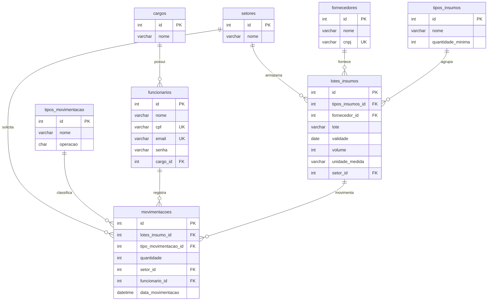

# Relatório de Revisão do Banco de Dados e Diagrama DER

**Projeto:** Sistema Desktop de Almoxarifado para Indústria de Bebidas (`bebidas_db`)  
**Arquivos Analisados:**
1. `Entregaveis/Banco de Dados/bebidas_db_2026-09-22T13_51_34.971Z.json` (Modelo exportado do DrawDB)
2. `Entregaveis/Banco de Dados/bebidas_db_2026-10-13T14_02_26.535Z.jpeg` (Captura visual do DER)
3. `Entregaveis/Banco de Dados/BancodoProjeto.sql` (Script SQL existente)

---

## 1. Pontos Fortes da Modelagem Atual
* **Separação entre Tipo de Insumo e Lote:** A distinção entre `TIPOS_INSUMOS` (definição abstrata: Concentrado de Guaraná, Garrafa PET 2L) e `LOTES_INSUMO` (instância física com validade e fornecedor) é excelente e reflete a realidade industrial de rastreabilidade (FIFO/PEPS).
* **Livro-Razão de Movimentações (Ledger Pattern):** A tabela `MOVIMENTACOES` atuando como histórico contábil de entradas e saídas garante que nenhum dado histórico seja perdido, atendendo com folga a RN-04.
* **Views de Saldo:** A implementação de `vw_quantidade_atual_por_lote` e `vw_quantidade_atual` automatiza o cálculo do estoque dinâmico sem armazenar campos calculados redundantes propensos a desincronização.

---

## 2. Inconsistências Críticas e Oportunidades de Melhoria

### ⚠️ Inconsistência 1: Descumprimento da Regra de Mínimo de 3 Registros (Edital SENAI)
* **O que diz o Edital (Item 3.2):** *"O script deverá conter tabelas (...), relacionamentos e **pelo menos três registros para cada tabela criada**."*
* **O que está no script original:**
  * `CARGOS`: apenas 2 registros.
  * `TIPO_MOVIMENTACAO`: apenas 2 registros.
  * `FORNECEDORES`: apenas 2 registros.
  * `SETORES`: apenas 2 registros.
  * `LOTES_INSUMO`: apenas 2 registros.
  * `FUNCIONARIOS`: apenas 2 registros.
* **Risco:** Perda direta de pontos na avaliação do SENAI.
* **Solução:** Adicionar um 3º registro consistente para todas as tabelas.

### ⚠️ Inconsistência 2: Ausência de Criação e Seleção do Banco no Script SQL
* **Problema:** O script começa diretamente com `CREATE TABLE CARGOS...` sem declarar `CREATE DATABASE IF NOT EXISTS bebidas_db;` e `USE bebidas_db;`. Se o professor/avaliador executar o arquivo no MySQL Workbench ou terminal sem selecionar um banco antes, o script falhará com o erro `No database selected`.
* **Solução:** Incluir a criação explícita do schema com charset `utf8mb4`.

### ⚠️ Inconsistência 3: Ambiguidade do Campo `volume` em `LOTES_INSUMO`
* **Problema:** Na tabela `LOTES_INSUMO` existe `volume INTEGER`. No entanto, na view de saldo (`vw_quantidade_atual`), a quantidade disponível é calculada unicamente somando e subtraindo os registros de `MOVIMENTACOES`.
* **Consequência:** Se um lote for inserido com `volume = 200`, mas nenhuma movimentação de "Entrada" for registrada na tabela `MOVIMENTACOES`, o saldo na view continua sendo `0`!
* **Solução Recomendada:**
  1. Manter `volume` documentado como o **volume/quantidade inicial de entrada** daquele lote.
  2. No momento do cadastro do lote pelo sistema ou no script SQL, garantir que seja gerado um registro correspondente em `MOVIMENTACOES` com tipo "Entrada por fornecedor".

### ⚠️ Inconsistência 4: Falta de Restrições `UNIQUE` em Campos Críticos
* **Problema:**
  * `FUNCIONARIOS.email` e `FUNCIONARIOS.cpf` não possuem restrição `UNIQUE`. O sistema permitiria dois funcionários com o mesmo e-mail, corrompendo a lógica de autenticação (RF-01).
  * `FORNECEDORES.cnpj` não possui restrição `UNIQUE`.
  * `LOTES_INSUMO.lote` deveria ser único por fornecedor/tipo.
* **Solução:** Adicionar `UNIQUE KEY` para `email`, `cpf` e `cnpj`.

### ⚠️ Inconsistência 5: Nomenclatura Mista e Case Sensitivity
* **Problema:** No DrawDB (JSON) as tabelas estão em minúsculas (`tipos_insumos`, `lotes_insumos`, `cargo`), enquanto no arquivo SQL estão em maiúsculas (`CARGOS`, `TIPO_MOVIMENTACAO`, `LOTES_INSUMO`). Além disso, no DrawDB a tabela é `cargo` (singular) e no SQL é `CARGOS` (plural).
* **Solução:** Padronizar todas as tabelas em minúsculas com snake_case (`cargos`, `tipos_insumos`, `lotes_insumos`, `movimentacoes`, etc.), compatível com qualquer sistema operacional (Windows, Linux, macOS).

### ⚠️ Inconsistência 6: Nome de Campo Reservado (`data_`)
* **Problema:** Em `MOVIMENTACOES`, a coluna foi nomeada como `data_` para contornar a palavra reservada `data`.
* **Solução:** Renomear para `data_hora` ou `data_movimentacao` com valor padrão `DEFAULT CURRENT_TIMESTAMP`.

---

## 3. Diagrama Entidade-Relacionamento Revisado (Mermaid)

---

## 4. Como atualizar no DrawDB.app
Se desejar reimportar ou ajustar no DrawDB:
1. Abra o [DrawDB.app](https://drawdb.app).
2. Na tabela `funcionarios`, adicione o modificador `Unique` para `email` e `cpf`.
3. Na tabela `fornecedores`, adicione `Unique` para `cnpj`.
4. Na tabela `movimentacoes`, renomeie `data` para `data_movimentacao` do tipo `DATETIME`.
5. Renomeie a tabela `cargo` para `cargos` (no plural) para manter o padrão das demais.
