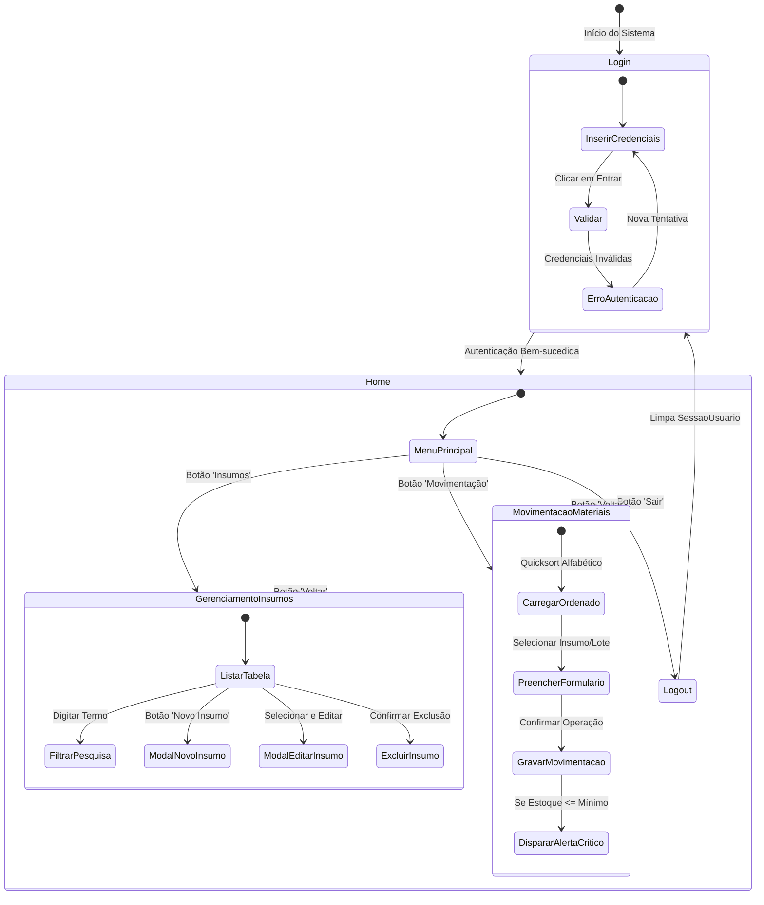

# Arquitetura de Interface e Fluxo de Telas (JavaFX)

**Projeto:** Sistema Desktop de Almoxarifado para Indústria de Bebidas  
**Tecnologia:** JavaFX 17+ / FXML / Scene Builder / NetBeans  

Este documento descreve a experiência do usuário, a transição entre telas, os componentes FXML e as regras de interface gráfica.

---

## 1. Fluxograma de Navegação



---

## 2. Detalhamento de Cada Tela

### 2.1. Tela 1: Autenticação (`login.fxml`)
* **Objetivo:** Garantir acesso restrito aos funcionários autorizados.
* **Componentes Principais:**
  * `ImageView imgLogo`: Identidade visual da indústria de bebidas.
  * `TextField txtEmail`: Campo para login do funcionário.
  * `PasswordField txtSenha`: Campo protegido para a senha.
  * `Button btnEntrar`: Dispara a validação.
  * `Label lblFeedback`: Mensagem de status/erro em vermelho.
* **Comportamento e Regras:**
  * Valida se os campos não estão vazios antes de consultar o banco.
  * Caso as credenciais não coincidam, exibe alerta modal ou mensagem na própria tela e limpa apenas o campo de senha, mantendo o foco nele.
  * Em caso de sucesso, armazena o funcionário na classe `SessaoUsuario` e carrega a tela `Home.fxml`.

### 2.2. Tela 2: Inicial (`home.fxml`)
* **Objetivo:** Dashboard central de navegação e identificação do operador.
* **Componentes Principais:**
  * `Label lblUsuario`: "Olá, Matheus Silva | Cargo: Operador de Estoque".
  * `Button btnInsumos`: Acesso rápido ao módulo de catálogo e insumos.
  * `Button btnMovimentacoes`: Acesso ao módulo de entrada/saída.
  * `Button btnSair`: Logout seguro.
* **Comportamento e Regras:**
  * O nome e o cargo do usuário devem ser carregados dinamicamente de `SessaoUsuario.getUsuarioAutenticado()`.
  * Ao clicar em "Sair", confirma a intenção, invalida a sessão e redireciona para `login.fxml`.

### 2.3. Tela 3: Gerenciamento de Insumos (`insumos.fxml`)
* **Objetivo:** Manutenção cadastral das matérias-primas e embalagens.
* **Componentes Principais:**
  * `TextField txtBusca`: Barra de busca textual com evento `onKeyTyped` filtrando a tabela em tempo real.
  * `TableView<InsumoDTO> tblInsumos`:
    * Coluna 1: Nome do Insumo (ex: Garrafa PET 2L)
    * Coluna 2: Saldo Atual (ex: 400 unidades)
    * Coluna 3: Estoque Mínimo (ex: 500 unidades)
    * Coluna 4: Situação (badge verde "OK" ou badge vermelho "CRÍTICO")
  * Botões de Ação: `btnNovo`, `btnEditar`, `btnExcluir`, `btnVoltar`.
* **Formulário de Cadastro/Edição (Modal ou Painel):**
  * `txtNome`: Obrigatório, mínimo 3 caracteres.
  * `txtQtdMinima`: Obrigatório, numérico $\ge 0$.
  * Validação prévia em Java antes de executar a query no MySQL.

### 2.4. Tela 4: Movimentação de Materiais (`movimentacao.fxml`)
* **Objetivo:** Registro ágil de retiradas e reposições de insumos.
* **Componentes Principais:**
  * `ComboBox<TipoInsumo> cbInsumo`: Carrega todos os insumos **obrigatoriamente ordenados alfabeticamente pelo algoritmo Quicksort**.
  * `ComboBox<LoteInsumo> cbLote`: Filtrado automaticamente pelo insumo selecionado (exibindo lote, validade e saldo atual).
  * `ComboBox<TipoMovimentacao> cbTipo`: "Entrada por Fornecedor" ou "Saída por Produção".
  * `ComboBox<Setor> cbSetor`: Setor solicitante (ex: "Linha de Envase", "Preparação de Xarope").
  * `TextField txtQuantidade`: Quantidade a movimentar (número inteiro positivo).
  * `DatePicker dpData`: Data da operação (padrão preenchido com a data atual).
  * `Label lblResponsavel`: Preenchido automaticamente com o usuário autenticado (imutável).
  * `Button btnConfirmar`: Registra a transação.
  * `Button btnVoltar`: Retorna à tela inicial.
* **Regras Críticas:**
  * Se for operação de Saída e a quantidade for maior que a disponível no lote, abortar a operação com aviso `Estoque insuficiente no lote selecionado`.
  * Após confirmação bem-sucedida, se o estoque total do insumo atingir ou ficar abaixo da `quantidade_minima`, emitir pop-up sonoro/visual:
    > ⚠️ **Alerta de Estoque Crítico:** O insumo **Concentrado de Guaraná** atingiu 45 Litros, abaixo do limite de segurança cadastrado (50 Litros)!

---

## 3. Gestão de Sessão (`SessaoUsuario`)
A classe `SessaoUsuario` mantém em memória o estado do operador atual:
```java
package com.senai.bebidas.util;

import com.senai.bebidas.model.Funcionario;

public class SessaoUsuario {
    private static Funcionario usuarioAutenticado;

    public static void iniciarSessao(Funcionario funcionario) {
        usuarioAutenticado = funcionario;
    }

    public static Funcionario getUsuarioAutenticado() {
        return usuarioAutenticado;
    }

    public static void encerrarSessao() {
        usuarioAutenticado = null;
    }

    public static boolean isAutenticado() {
        return usuarioAutenticado != null;
    }
}
```
Isso garante que todas as telas e transações de movimentação capturem o usuário logado sem necessidade de passar parâmetros manuais entre Controllers.
